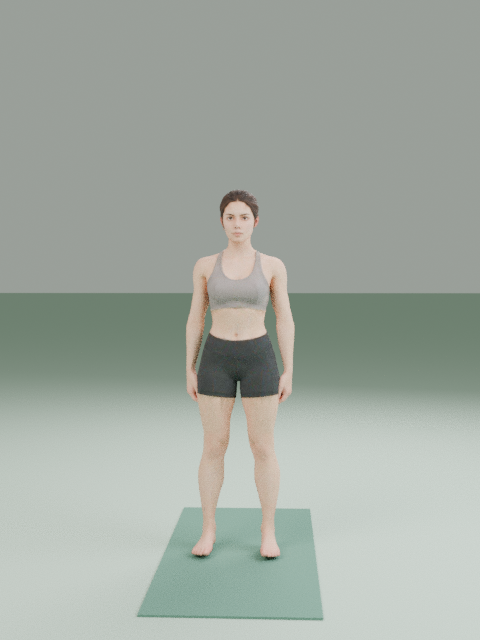
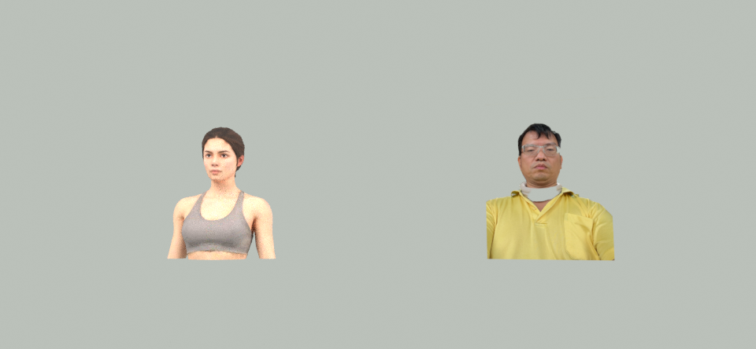
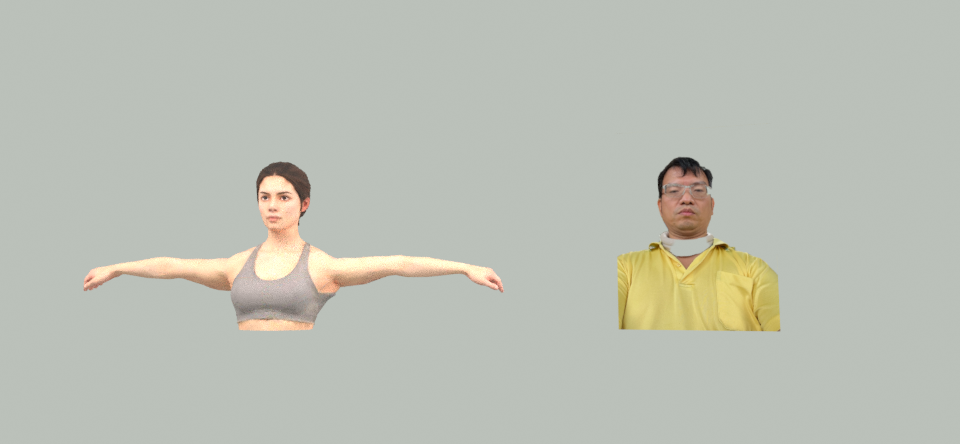

# Yoga2 · 3D 瑜伽練習室

手機網頁的 3D 女性教練原型。完整分期規劃見 [3D_Yoga_Web_Plan.md](./3D_Yoga_Web_Plan.md)。

## 目前版本 v0.8.3（M8 匿名除錯回報）

按場景上的「回報問題」，擷取相機圖、當下練習場景與控制介面（包含全螢幕模式）、版號、螢幕尺寸、AI 與校準狀態，打包 JSON／PNG／ZIP 後建立 GitHub Issue。由專用 GitHub App 代送，訪客不需要登入 GitHub／ChatGPT。主站仍為 GitHub Pages；回報服務為公開 Worker，私鑰在後端加密保存。擁有者需先完成一次性 App 建立／安裝。

M8 匿名流程已實作。**專用 App 仍待擁有者在 GitHub 核准建立／安裝，完成前上傳保持停用（503），不算完整驗收。** 設定入口與操作見 [debug-server/README.md](./debug-server/README.md)。仍須用未登入的手機驗收實際 Issue 與圖片品質。

## 保留的 M7 AI 骨架

- 開啟相機後，預設顯示青綠色 AI 骨架：MediaPipe Pose Landmarker 即時推估身體關節，依每個關節的可見度／存在信心決定連線，不是預先畫好的固定姿勢。
- 骨架繪在真人去背影像所在的 3D 平面，與人物共用同一幀、鏡像、位置、縮放和觀看角度。這是影像關節投影，不是精確三維人體量測。
- 「AI 骨架」可獨立隱藏；「教練骨架」可顯示橘色實際模型骨架，跟隨站姿、上舉、側伸展和展臂動作。兩個開關在全螢幕也可操作。
- 手腳看不清楚時只隱藏相關關節／連線，保留其他清楚的部分。沒有偵測到人體、多人、暗處、過期、相機關閉或切背景時不顯示舊骨架；半身去背仍可使用。
- 每個骨架使用兩個 instanced draw calls，避免手機線寬限制與大量獨立物件。關閉時釋放骨架幾何、材質及 instance buffer。

128 項測試通過。已用真實 Luna GLB 驗證主要骨架及四種姿勢；雲端瀏覽器不支援 WebGL，實際手機的 AI 偵測、線條可讀性、對齊與效能仍待驗收。

## 已保留的真人入場（M6）

按「開啟相機」即自動去背入場，按「關閉相機」同時停止相機與離場。沒有獨立入場按鈕或相機預覽。去背後的鏡像影像會與 Luna 並排出現在同一個 3D 場景，可調整左右位置、人物大小與重新對齊地面。

- 共用同一個相機；去背採獨立 Selfie Multiclass（約 16.4 MB），半身／近距離不需先辨識到雙腳。姿勢分析仍用原本 Pose Landmarker。人像模型延遲載入並在關閉相機時釋放。
- 橫向場景左邊 Luna、右邊真人；手機橫放時依可視高度顯示完整場景，課程控制置右。
- 相機影像與遮罩來自同一個擷取幀，最長邊 512px；Worker 與主執行緒備援使用相同處理邏輯。沿用單幀推論、降頻與省電模式。
- 比例與站位採第一次有效全身／臉部畫面校準，避免伸展時不斷縮放；橫直向比例改變時重新校準，也可手動對齊。
- 關閉相機、切背景、裝置中斷、過期畫面、偵測到多人或無有效人像遮罩時隱藏真人；不把關閉前的延遲結果重新放回場景。
- 去背失敗保留姿勢觀察；依使用者需求不顯示原始相機預覽。關閉真人會釋放貼圖、幾何與材質資源。
- 這是面向觀看者的即時影像平面，不是完整 3D 人體重建；旋轉視角無法看到真人未拍到的角度。影像不錄製、不上傳。

目前 128 項自動測試通過。真人分割邊緣、iPhone／Android 相容性、與帶練／語音同時運行的流暢度和發熱，仍待手機實測；自動測試中的合成遮罩不代表真實模型準確率。

## 固定比例與站位（v0.7.1）

- 教練固定左側、真人固定右側，預留兩人伸展空間。人物輪廓變寬時不再改變位置、縮放或鏡頭距離。
- 全身鏡頭使用全身比例；半身鏡頭優先以臉部皮膚區域校準到教練相同的頭肩尺度，對齊頭部高度，避免用整個含背景輪廓的高度決定比例；半身鏡頭時教練也同步採半身顯示。
- 比例在首次有效畫面校準後鎖定；姿勢、遮擋或輪廓改變不重新校準。只有「重新校準比例」、重新開相機或影像長寬比改變時重設。
- 保留原始影像長寬比，不因伸手變寬而拉伸影像。進出全螢幕或旋轉手機只重新配置可視範圍，不按人物輪廓移位。
- 精細去背改用 Selfie Multiclass 256×256，保留頭髮／身體皮膚／臉部皮膚／衣物，限制配件區域並刪除游離背景碎塊。首次約 16.4 MB，比舊模型更重，手機效能仍需實測。
- 全螢幕保留相機、播放／暫停、倒數與退出控制。瀏覽器不提供原生 API 時使用可視區域滿版備援。

`practice-layout.test.js` 驗證伸展前後的固定站位及鏡頭；`portrait-mask.test.js` 驗證分類合併、椅子區域清理、臉部比例及實際場景 mesh 不移位／不拉伸。舊的動態寬度構圖已移除。

## 已保留的版號與教練升級（M4.5／M5）

- 右上角顯示版號，點擊會檢查最新版並重新載入；檢查失敗可重試，不會中斷目前畫面。
- 更新入口獨立於 3D 啟動流程；新版模組與樣式使用一致版本參數，避免沿用舊版快取。
- Luna 女性教練：白皙自然膚色、盤髮、運動上衣與短褲；預設正面站立。
- 模型約 1.96 MB、36,000 個三角形，含真正的 `jawOpen` 嘴型目標，保留三個動作、相機及語音功能。
- 128 項自動測試通過。已以實際程式姿勢匯出並離線渲染檢查；手機外觀、觸控與效能仍待實機驗收。



## 語音功能（M4）

- 按「開啟語音」才啟動中文語音辨識；可說「慢一點」「再一次」「暫停」「繼續」。
- 「慢一點」逐步降至 1×／0.5×；「再一次」重播目前動作，課程完成後則整段重播；暫停與繼續是明確操作，不會因重複指令反向切換。
- 支援目前動作、下一個動作、剩餘課程時間、動作做法及新鮮的姿勢摘要。這是課程規則問答，未接入通用對話模型。
- 系統中文語音確認回覆；播放時停止收音，結束後延遲 800 ms 才恢復。閒置、切背景、拒絕權限或服務失敗會停止聆聽。
- 簡單嘴型只在語音真正開始時開合，結束／取消／失敗立即閉合；目前為示意效果，不是逐音素同步。
- 所有功能均有按鈕或文字替代，語音不支援時仍能帶練。

語音辨識使用 `SpeechRecognition`／`webkitSpeechRecognition`，相容性與中文辨識依瀏覽器而定；音訊可能由瀏覽器的語音服務商處理。語音合成也可能使用系統或服務商的聲音。這與相機影像本機分析不同。網站不儲存錄音或對話紀錄、不要求 API key。

## 已保留的姿勢觀察功能（M3）

- 主動按「開啟相機」才請求前鏡頭，不請求麥克風。
- 相機預覽已依新需求移除；原始影像僅在背景分析，去背人物直接顯示於場景。關閉時釋放相機。
- 固定版本 MediaPipe Pose Landmarker Lite，在手機本機辨識，不錄影、不上傳影像。
- 優先在 Worker 分析，瀏覽器不支援時以主執行緒低頻分析；一次只分析一幀，依分析速度降低頻率。
- 低信心、身體出框、光線偏暗、多人或畫面過期時，停止動作判斷並提示調整。
- 只在停留階段給有限回饋；切動作／暫停會清除舊觀察，至少三次穩定觀察才顯示動作回饋。
- 拒絕權限、模型下載失敗、取消載入及裝置中斷皆有處理；切背景會關閉相機。

| 動作 | 這版能觀察的條件 | 不判定的部分 |
| --- | --- | --- |
| 站姿上舉伸展 | 兩個手腕是否出現在頭部上方 | 完整關節排列或安全性 |
| 左右側伸展 | 雙手上舉、上半身相對髖部的側傾方向 | 脊椎彎曲與實際三維角度 |
| 展臂開胸 | 雙手是否展開並接近肩膀高度 | 向後開胸的深度 |

這些條件與信心門檻是原型規則，尚未用真實練習者資料校準，不代表姿勢正確或安全。正式效果仍需在手機測試。

## 已保留的帶練功能（M2）

- 現成女性 GLB 人物、燈光、瑜伽墊與基本場景。
- 手指拖曳旋轉、雙指縮放，正面／側面／背面及視角重設。
- 三個動作自動依序帶練：站姿上舉伸展 16 秒、左右側伸展 32 秒、展臂開胸 20 秒，1× 共 68 秒。
- 開始、暫停、繼續、整段重播、進度拖曳、0.5×／1×／1.5× 速度。
- 當前動作、階段提示、動作剩餘時間、整段剩餘時間與下一個動作。
- 點選清單中的動作會跳到該動作並暫停，按開始／繼續才播放。
- 三個動作都從雙手放下的站姿開始，結束回到同一站姿後再銜接。
- 模型載入與失敗提示、重試、WebGL 不支援或 context lost 提示。
- 省電模式降低像素比及繪製頻率，切到背景時暫停播放。
- 不開相機或語音也可照常帶練；不需要帳號或付費 AI API。

角色為 CC0 素材衍生的 Luna。示範為骨架動作原型，尚未經瑜伽教練校正。素材來源與使用條件見 [THIRD_PARTY_ASSETS.md](./THIRD_PARTY_ASSETS.md)。Git 收錄手機版 Luna；建置會驗證 SHA-256，原始高面數模型不收錄。

## 本機執行

需求：Node.js 22 以上。

```sh
npm ci
npm run check
npm run build
python3 -m http.server 8080 --directory dist
```

打開 `http://localhost:8080`。請使用 HTTP 伺服器，不能直接以 `file://` 開啟 HTML。正式部署須提供整個 `dist/`；所有執行資源使用相對網址，可部署於子路徑。

## GitHub Pages

網站路徑：`https://wangchengyeh.github.io/Yoga2/`。沿用儲存庫現有的 **Deploy from a branch → main → / (root)** 設定，GitHub 自動發布根目錄 `index.html`，不需要改成 GitHub Actions 部署來源。

Pages 入口使用固定版本的 jsDelivr Three.js 模組與本站 Luna GLB，首次開啟需要連網。`npm run build` 另產生所有執行素材放在同一網站的 `dist/` 版本，適合其他靜態主機。`scripts/sync-pages.mjs` 由共用 HTML 產生 Pages 首頁，避免兩版介面不同步；修改介面後執行建置並一併提交更新的 `index.html`。

`.github/workflows/pages.yml` 執行語法、建置、動作及模型測試；網站發布由 GitHub 原有的 Pages 流程處理，避免兩個部署工作互相覆蓋。

## 檔案結構

| 位置 | 用途 |
| --- | --- |
| `src/index.html`、`src/style.css` | 繁體中文介面、手機排版 |
| `src/app.js` | Three.js 場景、角色載入、骨架控制、播放器 |
| `src/motion.js`、`src/rig.js` | 伸展時間軸、提示規則與骨架方向控制 |
| `src/course.js` | 三個動作、連續課程時間軸與播放狀態控制 |
| `src/pose-rules.js` | 關節信心、入鏡檢查、三個動作有限規則與穩定濾波 |
| `src/camera-session.js` | 相機授權、取消、單幀排程、停止與資源釋放 |
| `src/pose-panel.js`、`src/pose-engine.js`、`src/pose-worker.js` | 相機分析、SDK 與 Worker／低頻備援分析 |
| `src/voice-intents.js`、`src/voice-session.js` | 指令／課程問答、聆聽與回覆狀態控制 |
| `src/voice-panel.js`、`src/mouth.js` | 語音介面、觸控替代與嘴型示意 |
| `src/cutout-core.js`、`src/pose-frame.js` | 去背遮罩、同幀影像擷取、校準與生命週期 |
| `src/human-scene.js`、`src/human-panel.js` | 場景影像平面、位置／大小控制與資源釋放 |
| `public/models/` | GLB 人物素材 |
| `scripts/build.mjs` | 複製網頁、模型及必要的 Three.js 模組到 dist |
| `tests/` | 動作時間軸、真實模型骨架與手腳位置測試 |

## 第一版驗收

- [x] 實作女性角色、視角切換及示範播放。
- [x] 實作載入、錯誤與重試介面。
- [ ] 目標 iPhone／Android 實機：確認全身與上舉手臂可見。
- [ ] 實機記錄首次載入秒數、播放是否流暢、連續 5 分鐘的發熱情況。

桌面瀏覽器檢查不能取代手機實機驗收。模型就緒時間會顯示在開發者主控台 `Yoga2: model ready in …s`。

目前檢查紀錄：程式語法、建置、時間軸與真實 GLB 骨架測試通過；雲端測試瀏覽器的 WebGL 被停用，已確認失敗提示正常，但未完成 3D 渲染與觸控互動實測。

### 站姿與動作回歸測試

執行 `npm test`，或用 `npm run check` 一次完成語法與全部測試。CI 在每次推送到 `main` 時自動執行。

測試讀取與網頁相同的 GLB，只略過貼圖解碼，保留網格、骨架、蒙皮權重與轉換矩陣，不依賴 GPU。檢查項目包含：預設站立與手放下、實際頭部網格高於鞋子、鞋子接近地墊、身體沒有沿深度軸平躺、不同初始方向校正至正面、雙手上舉且腳不移動，以及重播／拖曳進度不累積姿勢誤差。

已修正一次真實問題：對帶有旋轉父節點的 Michelle 模型呼叫 `Skeleton.pose()` 會造成身體橫倒。保留 GLB 原有的局部骨架姿態可避免此問題；回歸測試同時檢查實際蒙皮頂點，避免只測關節座標造成誤判。這些測試仍不能取代手機上的渲染與觸控驗收。

## 下一階段

M3 的程式、建置與自動測試已完成。M1 的預設站姿已由使用者確認正確；相機權限流程、真實人體辨識、Worker 在 iPhone 上的相容性、偵測門檻、載入時間、流暢度與發熱仍需實機驗收。自動測試使用模擬相機與合成人體關節資料，不等於驗證辨識模型的真實準確率。

| 功能／動作 | 對應自動測試 |
| --- | --- |
| 站姿上舉伸展 | `reach` 時間曲線與人物網格：手高於頭、腳不動 |
| 左右側伸展 | `side` 時間曲線與人物網格：左右對稱側彎、手隨身體、腳不動 |
| 展臂開胸 | `open` 時間曲線與人物網格：手臂水平展開並略向後、頭腳穩定 |
| 三個動作銜接 | 16／48／68 秒課程邊界、每個動作起訖回到同一站姿 |
| 暫停／繼續 | 暫停時計時凍結，繼續後從原位置前進 |
| 重播 | 重複重播重設同一時鐘，人物不累積偏移 |
| 速度 | 0.5×／1.5× 的動畫進度、動作倒數、總倒數一致 |
| 選動作／拖進度 | 選動作後暫停、時間上下界、完成後再開始歸零 |
| 完成／切背景 | 結尾精確停止、切背景暫停且保留進度 |
| 低幀率 | 慢幀仍計入實際經過時間，不因繪圖變慢而少算 |

| M3 功能 | 對應測試 |
| --- | --- |
| 三個動作的有限觀察 | `pose-rules.test.js` 分別測上舉、左右側傾、展臂與高度 |
| 低信心／出框／暗處／多人 | 各種品質門檻會停止判斷；每個必要關節獨立測試 |
| 防止亂報與過期回饋 | 三次穩定取樣、階段／暫停狀態改變、延遲結果、畫面停滯 |
| 授權與取消 | 預設不請求、只開相機、拒絕／取消／安全來源與不支援情況 |
| 釋放與重試 | 等待權限或模型時取消、關閉釋放、裝置斷線、推論失敗、重試 |
| 效能排程 | 同一畫面不重算、只允許一幀推論、過慢推論清除舊回饋 |

| M4 功能 | 對應測試 |
| --- | --- |
| 慢一點／再一次／暫停／繼續 | `voice-intents.test.js` 分別驗證動作與時間／速度結果 |
| 不確定的指令 | 否定、混合指令與低信心不執行；只接受 final 結果 |
| 課程與姿勢問答 | 只用目前課程及有效、未過期的姿勢摘要，不猜測完整正確性 |
| 回音與重複結果 | 回覆時無收音；舊回呼、重複結果及舊語音結束事件無效 |
| 拒絕／失敗／不支援 | 停止且保留文字／按鈕，沒有無限重試；等待服務亦有逾時 |
| 嘴型 | 實際 GLB 嘴唇局部變形、不影響腳部、停止歸零、不支援模型可降級 |

目前 128 項測試通過。語音服務採模擬事件測試，嘴型採實際網格測試；不代表已驗證 iPhone 的收音、系統語音、回音效果或臉部視覺品質，這些仍待手機實測。

M5 已換成白皙膚色、運動服的 Luna，M6 已加入即時去背影像。M7 已在場景中加入 AI 骨架與教練骨架開關。

## 發布與更新測試

修改 `package.json` 版號並同步 lockfile，執行 `npm run build`，一併提交產生的 `src/release.js`、`version.json`、`index.html` 與模組版本參數。Pages 發布後，使用者點右上角版號即可更新。首次加入這項功能前開啟的舊頁面，需要先手動重新整理一次。

| 功能 | 對應測試 |
| --- | --- |
| 版號、檢查與重新載入 | `update.test.js`：初始不連線、no-store 檢查、同版重載、網址與查詢參數 |
| 更新失敗與連點 | 網路／HTTP／無效資料可重試；連點只送出一次請求 |
| Luna 素材 | `character-asset.test.js`：雜湊、大小、面數、骨架與嘴型 |
| Luna 動作與嘴型 | 真實 GLB 的站姿、朝向、三個動作、腳部穩定及局部嘴型回歸測試 |

重製模型：依 `public/models/luna-source.json` 取得原始素材，再用 `scripts/build-coach.py`（Blender 4.3）產生手機版。`scripts/export-pose-preview.mjs` 匯出實際動作，`scripts/render-coach-preview.py` 提供離線視覺檢查。

## M6 測試與手機驗收

| 功能 | 自動測試 |
| --- | --- |
| 遮罩與影像 | `cutout.test.js`：前景／背景 alpha、柔化重採樣、不同解析度、不修改輸入、無效資料 |
| 相機與去背共用 | 同一幀先快照後推論、結果關閉前複製遮罩、只在入場時啟用、去背失敗降級 |
| 地面／鏡像／大小 | 頭腳與髖部校準、鏡像座標、地面高度、橫直向比例、位置／縮放範圍 |
| 延遲與中斷 | 過期／多人／低信心清除、開關與對齊代次、關閉期間的延遲結果、背景與裝置中斷 |
| 場景資源 | 真實 Three.js 平面、透明材質、鏡像貼圖、面向視角、關閉及重開資源釋放 |
| 介面 | `human-panel.test.js`：場景／相機就緒、入場與離場、位置大小、重新對齊、控制狀態 |
| 單幀排程 | `camera-session.test.js`：每幀的分割選項與相機取消／釋放回歸 |

手機驗收：開啟相機 → 近距離／半身自動入場 → 全身入鏡自動對齊地面 → 調整位置／大小 → 三個動作與語音 → 橫直向切換／重新對齊 → 關閉重開相機 → 關閉相機及切背景。記錄去背邊緣、幀率、延遲與連續五分鐘發熱情況。

### v0.6.1 修正驗收

- 回歸測試：沒有身體關節、只有近距離人像、腳不可見時仍可去背入場；全身可見時再切換地面校準。人像模型輸出使用其 `selfie` 前景標籤，不假設遮罩索引。
- 一鍵開啟／停止、相機先於場景就緒、背景返回、模型失敗與取消載入皆有測試。
- 瀏覽器檢查 844×390 橫向尺寸：場景高度 278px、底部 385px，課程位於右側；390×844 保留單欄排版。確認只有一個相機按鈕且沒有預覽視窗。
- 雲端瀏覽器無 WebGL；此版未完成真實手機去背渲染驗收。合成資料測試不能證明人像模型的真實辨識率。

## M7 測試對照

| 功能 | 對應測試 |
| --- | --- |
| AI 關節與鏡像 | `skeleton.test.js`：座標映射、肩部中點、每個關節的信心／存在／出框門檻 |
| 不確定的輸入 | 無人體、多人、暗處、NaN、低信心只刪除相應連線，不猜測遮擋部位 |
| 場景對齊 | 實際 Three.js instance matrix 端點與關節一致，包含鏡像、旋轉及非等比平面縮放 |
| 教練骨架 | 讀取實際 Luna GLB，檢查全部主要骨架及站姿／上舉／兩側伸展／展臂；父節點位移不造成漂移 |
| 顯示開關 | `human-panel.test.js`：隱藏 AI 骨架仍繼續去背與相機；再次開啟只使用新結果 |
| 舊結果與資源 | 過期、關閉相機、watchdog、舊代次結果立即隱藏，幾何／材質／instance 資源釋放 |

手機驗收：更新至 v0.7.0 → 開啟相機 → 全身入鏡觀察青綠色骨架 → 遮住一隻手確認對應連線隱藏 → 開啟教練骨架並播放三動作 → 檢查鎖定比例／全螢幕／旋轉手機 → 個別開關骨架 → 關閉相機及切背景確認沒有殘留。

## 真實人像回歸測試

已加入使用者提供的半身人像與 5 項真實模型整合測試，執行 `npm run test:portrait`；環境準備與觀察結果見 [tests/fixtures/README.md](./tests/fixtures/README.md)。GitHub CI 會重新執行兩個模型，檢查去背、頭肩 AI 骨架、畫面外的腳不補畫，以及左右構圖。這與原有 128 項單元／模型測試分開執行，不能替代手機即時相機與渲染驗收。

### v0.7.1 實例驗證

用回報截圖中已顯示的人像區域比較同一椅子取樣區：舊二分類模型平均前景信心約 1.00，新多分類人體合併約 0.065，經正式 JS 清理後該取樣區為 0。這是該案例區域的觀察，不能代表所有場景的辨識率。

`tests/fixtures/semantic-chair-mask.json` 只保存降採樣、量化後的分類機率，沒有照片 RGB 像素，供 CI 重播清理步驟。原本公開半身照片亦會重新跑新的模型，驗證臉／衣物保留、背景去除、AI 頭肩骨架及固定左右布局。

### 固定配置的離線視覺檢查

以下使用同一張真人測試照、正式去背／校準／固定構圖函式，以及網頁的實際 Luna 動作姿態，透過 Blender CPU 渲染。兩張圖採相同鏡頭與站位；真人為靜態照片，這些不是手機或網頁截圖。




可重製：先 `npm run test:portrait`，再執行 `node scripts/prepare-layout-qa.mjs`、`blender -b -t 2 --python scripts/render-layout-qa.py`。輸出在 `test-results/`，需與手機上的實際渲染分別驗收。

## M8 操作與驗收

1. 開啟相機，進入橫向全螢幕；看到問題時按「回報問題」。按鈕旁說明圖片將上傳到公開 GitHub。
2. 一般訪客不需登入；短效驗證自動執行。管理者需先在回報服務 `/setup` 完成一次性 App 建立／安裝。網路中斷時按「重試回報」，沿用已擷取的圖和 ID。
3. 看到成功連結後開啟 Issue，核對 `camera.png`、`scene.png`、`diagnostics.json`、`report.zip`；確認當下版號、尺寸、DPR、鏡像、校準與人物位置正確。
4. 相機關閉或辨識失敗仍可回報；JSON 標明缺失、過期或未配對的相機圖。場景圖只包含練習場景，沒有瀏覽器工具列或其他 App。

原始圖使用目前去背採用的同幀輸入，保留未鏡像 RGB；場景為鏡像。無有效推論幀時備援拍攝即時相機並明示未配對。圖片最大邊 2048 px，整包最多 8 MB。附件位於獨立回報分支；Issue 使用固定 commit URL，更新主程式不會改變舊附件。

測試：`npm run check` 包含 M8 的 ZIP／CRC、同幀與過期、螢幕尺寸、截圖失敗、無相機、身分／來源驗證、provider response、限流、重試與並行防重複測試。後端來源與部署說明在 [debug-server](./debug-server/README.md)。專用 App 尚待擁有者核准安裝，之後仍需手機實測通過才將 M8 標為完整驗收。

### v0.8.2 手機設定修正

修正 iPhone 內建瀏覽器表單帶 Origin:null 時被擋住；設定表單改用身分／路徑／期限綁定的簽章驗證。設定錯誤顯示 UTF-8 中文頁與返回入口。更新後需重新開啟 `/setup` 取得新表單。

### v0.8.3 設定憑證交換與續傳

修正 Worker 不支援 redirect:error 的錯誤，改為 manual 並拒絕轉址，不會把權杖轉送到其他站；同時明確綁定全域 fetch receiver。增加固定公開 GitHub 連線健康檢查（不帶 token）。GitHub manifest 交換失敗會加密保存原註冊，管理者可按「重試設定交換」，不必重新建立 App。v0.8.2 的舊失敗 callback 亦可在原頁重新整理接續。

### 全螢幕精簡

預設只留退出、相機、更多設定與底部動作／倒數／播放。骨架選項、觀看角度、省電、除錯回報收進「⋯」；教練名牌、水印、操作說明與常駐回報文字隱藏。回報狀態只在主動回報時出現，並可收起。退出全螢幕還原原位置與設定。
