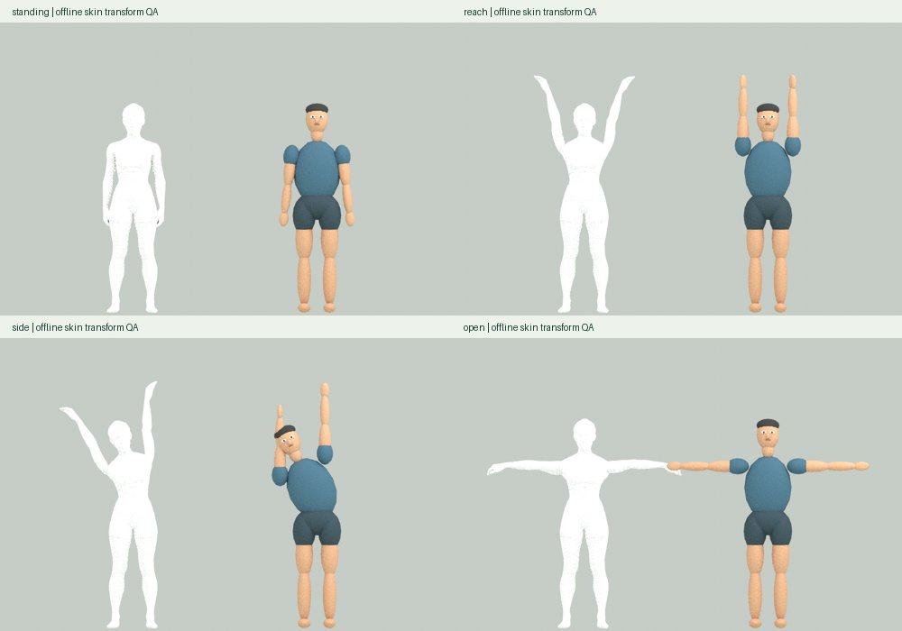

# M1 雙 Avatar — v0.9.24

依 PRODUCT_ROADMAP.md M1 實作；尚未通過完整實機退出條件。

## 已實作

- 左 Luna、右原創男性學員（22 骨 Humanoid、226,148 bytes GLB、CC0）。綁骨權重是分段剛性權重，非寫實平滑皮膚。
- 相機 → MediaPipe 原始 normalized/world landmarks → local quaternion → skinning。世界座標優先，無 world 資料時用含影像長寬比的 2D 方向；此模式不推測深度。
- 鏡像同時交換左右解剖索引及反轉 X；手臂、前臂、大腿、小腿、脊椎最小映射。根節點、骨長、比例與左右站位固定。
- visibility ≥ .65、presence ≥ .6、單人、非低光；資料必須新鮮且時間遞增。缺失關節從最後有效觀測起最多保持 300 ms，再漸回站姿；整份觀測 1.5 秒過期回中立。關閉相機、背景或重設立即清除舊 session。
- 學員骨架表示映射後姿勢；原始相機骨架可選擇在除錯畫面查看。姿勢判斷與 LLM 仍使用原始觀測及 Luna 骨架，不使用 Avatar 像素或映射後座標。
- 預設 `segment:false`，不建立 CutoutSession、人像 CanvasTexture、分割器或保留 RGBA；回報問題仍可按需擷取原始相機圖。舊去背模組與人像回歸測試保留，建置中也保留舊模型，不代表執行時載入。
- 回報包含 student-v1、retarget tracking/space/mirror、固定根節點資訊與零保留 RGBA 狀態；效能面板新增「學員骨架映射」CPU task，3D CPU 更新在映射開始前結束，避免同一執行緒父子工作重複計時。
- 修正全螢幕設定 summary 樣式污染，效能標題改為單行「效能監測 · CPU · GPU」。

## 證據與驗收

- `npm run check`：407 個自動測試；含原有課程、語音、排程回歸與新增 8 項 Avatar 測試。
- 真 GLB 載入、skin 頂點位移、三動作、鏡像/world、遮擋、過期、root/骨長鎖定、無分割無 RGBA、相機 session 回歸。
- 離線視覺檢查：`node scripts/export-dual-avatar-qa.mjs`，再 `blender -b -t 2 --python scripts/render-dual-avatar-qa.py`。四張圖在 `test-results/dual-avatar/`，使用實際 Three.js 骨變換；不等同手機瀏覽器截圖。Luna 在此離線工具不解碼貼圖，呈灰色。
- UI：`npm run test:settings-layout` 檢查 3 種視窗 × 面板開合。此 executor 不允許 Chromium socket 啟動，GitHub CI 的 6 種版面案例已通過；雲端瀏覽器標題 235×24 px、14 px 字級。雲端瀏覽器無 WebGL，不能作為角色顯示的驗收。
- 待驗收：iPhone Safari、實際相機三動作影片、M1 前後除錯包比較、30 分鐘穩定性。不可宣稱 M1 完成驗收或效能已達標。

## 限制與下一步

M2 處理完整 bind pose、扭轉、骨盆/頭部、平滑權重和獨立姿勢評估。M3 改善 Hint/語音路由。M4 才整合 CPU/GPU factor；目前沿用既有 FPS 排程。原始 world landmarks 可有遮擋深度噪音，這是最小動作視覺化而非動作捕捉精度承諾。

